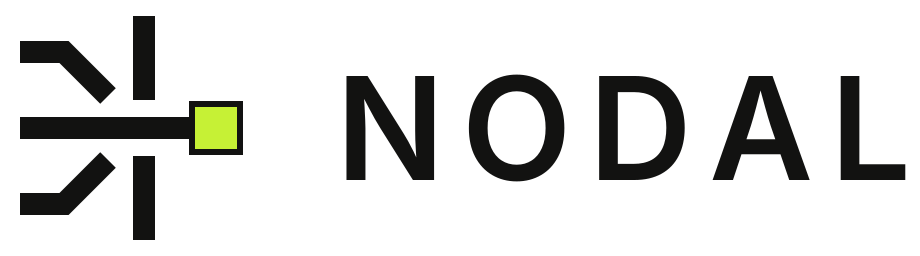
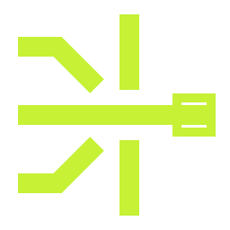

<p align="center">
  <picture>
    <source media="(prefers-color-scheme: dark)" srcset="assets/logo/svg/nodal-logo-dark.svg">
    
  </picture>
</p>

<h3 align="center">The Nodal mark, palette and type, as files and tokens.</h3>

---

## The mark

Three traces meet a boundary. Two stop; one passes through to a control point. Data paths converging at a node: what Nodal does with a request.

| On dark | On light | Mark |
|---|---|---|
|  |  |  |

## Files

```
assets/logo/svg/     nodal-logo-{dark,light,white,black,lime}.svg    horizontal lockup
                     nodal-mark-{dark,light,white,black,lime}.svg    mark only
                     nodal-app-icon-{dark,light}.svg                 square tile
assets/logo/png/     the same at @1x, @2x and @4x
assets/favicon/      favicon.svg, favicon.ico, 16–512 px PNGs
assets/social/       X profile (400, 800), X banner (1500×500, @2x), wide banner (2400×900)
assets/motion/       nodal-mark-animated.svg
assets/nodal-usage-sheet.pdf
tokens.json          colours and type as design tokens
tokens.css           colours as CSS custom properties
```

`dark` and `light` name the **background** the file is made for.

## Palette

| Token | Hex | Use |
|---|---|---|
| `graphite` | `#0B0C0A` | Primary background |
| `graphite2` | `#151713` | Raised surfaces |
| `rule` | `#32362C` | Lines and borders on dark |
| `paper` | `#ECEAE2` | Text and mark on dark |
| `muted` | `#8D8B81` | Secondary text on dark |
| `lime` | `#C6F135` | Signal. One accent per composition |
| `limeInk` | `#1B2400` | Text on lime |
| `ink` | `#121211` | Text and mark on light |
| `paperLight` | `#F3F1EA` | Light background (docs, print) |

## Type

- **Wordmark and headings:** Inter, 600. The wordmark is outlined in the logo files; Inter is not needed to use them.
- **Labels and metadata:** JetBrains Mono, 400–500, uppercase with 0.12em tracking.
- Both are under the SIL Open Font License 1.1.

## Using the mark

- **Clear space:** x = the size of the control-point square, which is 3/16 of the mark height, on every side.
- **Minimum size:** mark 16 px; lockup 96 px wide, 140 px or more recommended.
- **Don't** stretch, recolour, rotate, add effects, set it on busy imagery, use the lime mark on light backgrounds, change the wordmark font, or remove or move the control point.

Full guide: [nodal-usage-sheet.pdf](assets/nodal-usage-sheet.pdf).

## Rights

The Nodal name and mark identify Nodal. You may use these files to refer to Nodal, for example in articles, integrations lists or presentations, without modifying them and without implying endorsement. They are not covered by the MIT license of Nodal's code. Questions: contact@nodaltrace.si.
